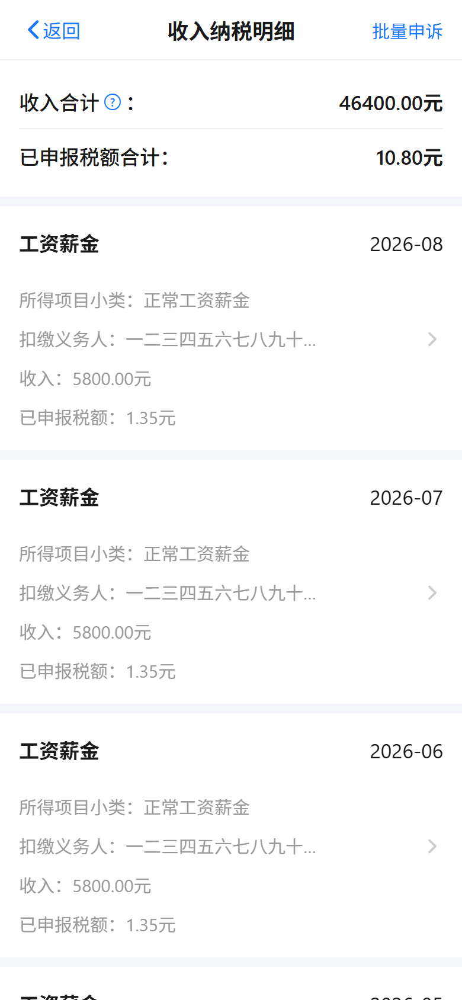

# Geshui · 个人所得税 App 界面复刻练习版

> 按个人所得税 App 的界面与操作习惯做的本地练习工具：可以自己录入、修改收入与扣除数据，看计算结果，全部数据只存在本机。个人独立开发，非官方，不能替代官方办税渠道。

**在线地址：** <https://geshuiapp.github.io/geshui2027/>
**本仓库：** Gitee 说明与截图镜像（<https://gitee.com/geshuiapp/geshui2027>），安装包与手册统一放在 GitHub Release
**当前版本：** V2.0.7（Android 7.0+，versionCode 35）

| 首页 | 收入纳税明细 | 我的 |
|---|---|---|
|  |  |  |

## 这个复刻版能做什么

- **界面与路径照原版做**：启动页、首页、五个标签、我的、收入纳税明细、任职受雇、专项附加扣除、关于与设置，页面结构和操作顺序按原 App 走。
- **数据自己造**：收入、税额、扣除、单位、家庭成员都可以自己填，用来演练查询、核对、汇算这些流程，不连税务系统、不产生真实申报。
- **本地存储**：录入的数据只在本机，换机或卸载即清空；只有激活、试用、反馈会联网。
- **算给你看**：按公开口径计算应纳税额与扣除，结果仅作参考。

## 可以自己改的内容

- **收入纳税明细**：新增记录（基本信息 + 详情）、修改、复制、删除；长按年度设年份范围、长按年份数字切换年份、长按记录卡调出操作菜单。
- **任职受雇**：新增单位、编辑单位信息；长按企业卡片可修改 / 复制 / 删除，只剩一条时不能删。
- **专项附加扣除**：按情形新增、编辑、保存，子女教育、继续教育、住房贷款利息、住房租金、赡养老人等常见项目都能自己填。
- **个人信息**：姓名、证件与其他证件信息、家庭成员、银行卡，可在「我的」里增改。
- **首页背景图与热区**：换成自己的图，拖动调整可点击区域，也能一键恢复默认图和默认热区。
- **意见反馈**：提交文字反馈并查看自己的历史反馈。

## 下载

| 内容 | 地址 |
|---|---|
| Android APK（V2.0.7） | <https://github.com/geshuiapp/geshui2027/releases/download/v2.0.7/geshui_v2.0.7.apk> |
| PDF 使用手册（A4 9 页） | <https://github.com/geshuiapp/geshui2027/releases/download/v2.0.7/geshui_manual_v2.0.7.pdf> |
| 在线说明书 / 免责声明 / 授权查询 | <https://geshuiapp.github.io/geshui2027/> |

只提供 V2.0.7 一个版本，旧版本入口已全部关闭。

## 授权

- 新设备首次安装可领 **15 分钟一次性试用**，试用期间需联网。
- 正式使用用 **`O|` 在线激活码**，码与设备码绑定、一次性使用；同一设备再激活新码会叠加时长。
- 换机不在 App 内自助完成，由管理员后台一次性改绑，新设备重新激活、旧设备失效。

## 本版更新（V2.0.7）

- 新增**资料修改次数**：个人授权按档位限制姓名/身份证换人次数，改邮箱、公司、备注不计次。
- 次数用尽后判定为商用，App 提示升级永久套餐；永久套餐资料修改不限次数。
- 后台授权页新增资料额度列与「+次数」，客服可按收款情况人工补次数。
- 保留日期级时间审计、7 天离线宽限、在线激活码与可关闭的新版本提醒。
- 旧版下载入口下线，只保留 V2.0.7。

## 免责

个人独立开发的非官方学习工具，与国家税务总局、各级税务机关、电子税务局及任何政府平台无隶属、合作、授权或认证关系；截图均为脱敏占位数据，计算结果仅供参考。
完整条款见 [disclaimer.html](https://geshuiapp.github.io/geshui2027/disclaimer.html)。联系方式：531707@gmail.com
